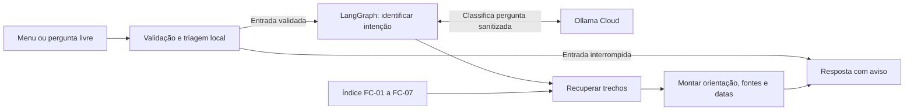

# Citizen Assist AI

**Integrantes:** Davi Teodoro Novais, Lourenço Borges da Silva e Matheus Jorge Santana.

Protótipo educacional em português que orienta sobre documentos pessoais com base nas fichas fictícias da Central do Cidadão de Aurora. A interface oferece um menu por assunto e um campo para perguntas livres.

## Instalação e execução no Windows

Com o Python 3.12 instalado, abra o PowerShell na raiz do projeto e execute:

```powershell
py -3.12 -m venv .venv
.\.venv\Scripts\python.exe -m pip install -r requirements.txt
```

Para habilitar perguntas livres, copie `.env.example` para `.env` na raiz e preencha `OLLAMA_API_KEY` com a sua chave do Ollama Cloud. Se o servidor já tiver a variável de ambiente `OLLAMA_API_KEY` configurada, ele a usará. Guarde a chave no servidor. O menu funciona mesmo sem acesso ao Ollama.

```powershell
.\.venv\Scripts\python.exe -m citizen_assist.web
```

Abra [http://127.0.0.1:8000/](http://127.0.0.1:8000/) no navegador do mesmo computador. Selecione **RG** no menu e procure os documentos da segunda via. Depois, pergunte **Como solicito um intérprete de Libras?**. Confira o agendamento com 48 horas de antecedência e a citação da FC-07, datada de 01/10/2026. Use **Ctrl+C** no terminal para encerrar.

Para executar os testes automatizados com os modelos simulados:

```powershell
.\.venv\Scripts\python.exe -m unittest discover -s tests -v
```

## Como funciona



O agente carrega as sete fichas Markdown em memória. O índice preserva o código, a data, a categoria e os trechos de cada ficha, incluindo condições como canal e motivo do pedido. O menu fornece a categoria diretamente. Para texto livre, o servidor envia a pergunta sanitizada ao `gemma4:31b`, valida a intenção retornada e seleciona os trechos pertinentes. A FC-07 entra quando há uma regra geral aplicável. O código compõe a resposta e inclui as citações com as datas.

O LangGraph organiza as etapas de um agente único porque os sete temas compartilham a mesma triagem, recuperação e montagem da resposta. O `gemma4:31b` foi validado para classificação em português. O `gpt-oss:20b` foi calibrado como juiz de uma família diferente e roda separadamente, apenas na avaliação com casos fictícios. [Base e contratos](docs/etapa_1.md) · [Primeiro fluxo](docs/etapa_2.md) · [Calibração do juiz](docs/etapa_3.md)

## Entrega

- [Plano de desenvolvimento](docs/plano_desenvolvimento.md)
- [Linha de base executada](avaliacao/linha_base.ipynb) e [instruções de reprodução](docs/etapa_3.md)
- [Reavaliação executada](avaliacao/reavaliacao.ipynb) e [registro da correção de privacidade](docs/etapa_4.md)
- [Relatório da etapa 5](docs/etapa_5.md) e [roteiro do teste com participantes](docs/teste_usuarios.md)
