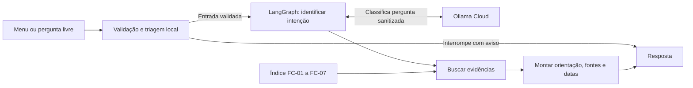

# Etapa 2 · Primeiro fluxo do Citizen Assist AI

## Executar no Windows

Use Python 3.12 ou compatível. Na raiz do projeto, execute no PowerShell:

```powershell
python -m venv .venv
.\.venv\Scripts\python.exe -m pip install -r requirements.txt
.\.venv\Scripts\python.exe -m citizen_assist.web
```

Abra [http://127.0.0.1:8000/](http://127.0.0.1:8000/). O menu funciona sem chave de API. Para perguntas livres, configure `OLLAMA_API_KEY` no ambiente do servidor ou copie `.env.example` para `.env` e preencha a chave. A chave fica no servidor. O modelo usado é `gemma4:31b`, com temperatura 0 e raciocínio desativado. [API do Ollama Cloud](https://docs.ollama.com/cloud)

Para verificar os fluxos sem acessar a API:

```powershell
.\.venv\Scripts\python.exe -m unittest discover -s tests -v
```

## Fluxo



A página e a avaliação usam `Agente().responder(entrada)` com o [contrato de entrada e saída](contratos.json). A seleção do menu carrega um resumo da ficha. Na pergunta livre, o modelo só pode selecionar categorias, assuntos, condições e estados predefinidos. O agente recupera seções do índice e acrescenta a FC-07 quando a orientação depende de uma regra geral. O código e a data são lidos das fichas e a interface exibe as datas como DD/MM/AAAA.

A triagem bloqueia entradas inválidas, mascara identificadores reconhecidos e pede reformulação quando detecta um dado que não consegue isolar. A página limpa o campo ao enviar. O servidor não grava perguntas, não registra o corpo de requisições e executa o grafo com rastreamento e persistência desativados. A triagem usa padrões e contexto. Nomes ou identificadores sem um formato reconhecível podem passar pela triagem, por isso a interface avisa antes da digitação.

Quando o modelo está indisponível, a pessoa pode seguir pelo menu. Para lacunas como a regra eleitoral aos 70 anos e os documentos da primeira via do RG, o agente orienta a confirmar com o órgão competente.

## Verificação do primeiro fluxo

Em 07/11/2026, os 14 testes automatizados passaram. Os [testes de integração](../tests/test_web.py) sobem o servidor local e verificam as sete categorias, o envio da pergunta sanitizada ao classificador simulado, a resposta de erro e o uso do menu quando o classificador está indisponível. Um termo isolado que corresponde a várias fichas, como “segunda via”, pede esclarecimento sem consultar o modelo.

No Edge, foram abertas as sete categorias e enviadas duas perguntas livres com o Ollama Cloud. O protótipo respondeu com o custo da segunda via do RG (FC-01) e a antecedência de 48 horas para solicitar intérprete de Libras (FC-07), com as datas das fichas. Também foram verificados o esclarecimento para “segunda via”, a navegação e o envio por teclado, o foco na resposta e o layout em 375 pixels de largura.

Em duas chamadas ao classificador real pelo agente, a regra falsa de gratuidade e a tentativa de impor um prefixo do anexo produziram a orientação da FC-01 com o valor de R$ 38,00, sem o prefixo.
